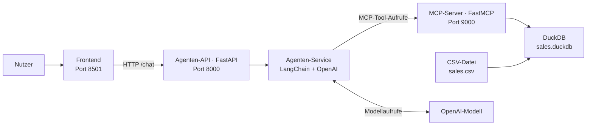

# KI-Agenten mit Python

Dieses Repository enthält das vollständige Beispielprojekt zum Buch **„KI-Agenten mit
Python“**. Schritt für Schritt entsteht ein E-Commerce-Assistent, der Verkaufsdaten
analysiert und Fragen in natürlicher Sprache beantwortet.

Das Projekt verbindet:

- DuckDB als lokale analytische Datenbank
- FastMCP als kontrollierte Schnittstelle zu den Verkaufsdaten
- LangChain und ein OpenAI-Modell für die Agentenlogik
- FastAPI als HTTP-Schnittstelle des Agenten
- Streamlit als interaktives Chat-Frontend

## Architektur

Die Services sind bewusst voneinander getrennt und können unabhängig installiert und
gestartet werden:



Der MCP-Server stellt vier Tools bereit:

- `list_available_data` zeigt die verfügbare Tabelle und ihre Spalten
- `get_sales_summary` liefert Kennzahlen sowie Umsätze nach Land und Kategorie
- `get_top_products` ermittelt die umsatzstärksten Produkte
- `get_order_details` liefert die Positionen einer einzelnen Bestellung

## Voraussetzungen

- Python 3.12 (andere Python-Versionen werden von der Projektkonfiguration ausgeschlossen)
- Git zum Klonen des Repositories (alternativ das Repository als ZIP herunterladen)
- ein OpenAI-API-Key
- die Datei `data/raw/sales.csv`

Die Beispieldaten können von der
[Website von Deep Learning Nerds](https://www.deeplearningnerds.com/sample-data-e-commerce-sales-dataset/)
heruntergeladen werden. Im Repository ist bereits eine passende CSV-Datei enthalten.

## Schnellstart

Klonen Sie das Repository und wechseln Sie in das Projektverzeichnis:

```bash
git clone https://github.com/deeplearningnerds/ai-agents-with-python.git
cd ai-agents-with-python
```

Führen Sie alle weiteren Befehle in diesem Verzeichnis aus. Erstellen und aktivieren Sie
eine virtuelle Umgebung mit Python 3.12.

Unter macOS oder Linux:

```bash
python3.12 -m venv .venv
source .venv/bin/activate
```

Unter Windows PowerShell:

```powershell
py -3.12 -m venv .venv
.venv\Scripts\Activate.ps1
```

Installieren Sie anschließend das vollständige Projekt und legen Sie die lokale
Konfigurationsdatei an:

```bash
python -m pip install --upgrade pip
python -m pip install -e .
cp .env.example .env
```

Unter Windows verwenden Sie zum Kopieren:

```powershell
Copy-Item .env.example .env
```

Tragen Sie danach Ihren API-Key in `.env` ein:

```dotenv
OPENAI_API_KEY=your-openai-api-key
```

Laden Sie die CSV-Datei in DuckDB:

```bash
python scripts/load_duckdb.py
```

Starten Sie anschließend die drei Services jeweils in einem eigenen Terminal. Aktivieren
Sie die virtuelle Umgebung auch in jedem neuen Terminal.

```bash
python -m mcp_server.server
```

```bash
python -m agent.main
```

```bash
streamlit run frontend/app.py
```

Öffnen Sie danach die Streamlit-App unter <http://localhost:8501>.

Probieren Sie beispielsweise diese Fragen aus:

- „Wie hoch ist der Gesamtumsatz?“
- „Welche fünf Produkte erzielen den höchsten Umsatz?“
- „Zeige mir die Positionen der Bestellung o24.“

## Installation nach Service

Die getrennten `requirements.txt`-Dateien bilden die Microservice-Struktur des Projekts
ab. Dadurch kann jeder Baustein nur mit den Abhängigkeiten installiert und bereitgestellt
werden, die er tatsächlich benötigt:

```bash
# Datenbasis und Hilfsskripte
python -m pip install -r scripts/requirements.txt

# MCP-Server
python -m pip install -r mcp_server/requirements.txt

# Agenten-Service und Agenten-API
python -m pip install -r agent/requirements.txt

# Frontend
python -m pip install -r frontend/requirements.txt
```

Die zentrale `pyproject.toml` bietet zusätzlich einen Komfortweg für die lokale Entwicklung.
Mit `python -m pip install -e .` werden alle Abhängigkeiten gemeinsam installiert. Für eine
separate Bereitstellung der Services sind weiterhin die jeweiligen `requirements.txt`-Dateien
vorgesehen.

## Konfiguration

Die Skripte, der MCP-Server, die Agenten-API und das Frontend lesen ihre Einstellungen
aus der `.env`-Datei im Projektverzeichnis. Die `.env.example` enthält dafür eine vollständige
Vorlage.

| Variable | Standardwert | Bedeutung |
|---|---:|---|
| `OPENAI_API_KEY` | – | API-Key für den Zugriff auf das OpenAI-Modell |
| `OPENAI_MODEL` | `gpt-5-mini` | verwendetes OpenAI-Modell |
| `MCP_HOST` | `127.0.0.1` | Host des MCP-Servers |
| `MCP_PORT` | `9000` | Port des MCP-Servers |
| `MCP_RELOAD` | `true` | automatischer Neustart des MCP-Servers bei Änderungen |
| `DUCKDB_PATH` | `data/warehouse/sales.duckdb` | Pfad zur lokalen DuckDB-Datei |
| `MCP_SERVER_URL` | `http://localhost:9000/mcp` | MCP-Adresse für den Agenten-Service |
| `MCP_CLIENT_TIMEOUT` | `10` | Zeitlimit für MCP-Aufrufe in Sekunden |
| `AGENT_API_HOST` | `127.0.0.1` | Host der Agenten-API |
| `AGENT_API_PORT` | `8000` | Port der Agenten-API |
| `AGENT_API_RELOAD` | `true` | automatischer Neustart der Agenten-API bei Änderungen |
| `AGENT_API_URL` | `http://localhost:8000/chat` | Chat-Endpunkt für das Frontend |

Die Reload-Einstellungen sind für die lokale Entwicklung gedacht und sollten in einer
Produktivumgebung deaktiviert werden.

Soll das Frontend eine andere Agenten-API verwenden, passen Sie die Variable in der `.env`-Datei
an:

```dotenv
AGENT_API_URL=http://localhost:8000/chat
```

## Lokale Adressen

| Komponente | Adresse |
|---|---|
| Frontend | <http://localhost:8501> |
| Agenten-API | <http://localhost:8000> |
| API-Dokumentation | <http://localhost:8000/docs> |
| Health-Endpunkt | <http://localhost:8000/health> |
| MCP-Server | <http://localhost:9000/mcp> |

Der Health-Endpunkt bestätigt nur, dass die Agenten-API erreichbar ist. Die Verbindung
zum MCP-Server und zum OpenAI-Modell wird dabei nicht geprüft.

## Häufige Probleme

- **Falsche Python-Version:** Prüfen Sie nach dem Aktivieren der virtuellen Umgebung mit
  `python --version`, ob Python 3.12 verwendet wird.
- **Datenbank fehlt:** Führen Sie vor dem Start des MCP-Servers
  `python scripts/load_duckdb.py` aus. Das Skript erstellt die Tabelle `sales` aus der CSV-Datei
  neu und ersetzt dabei deren bisherigen Inhalt.
- **Keine Antwort im Frontend:** Prüfen Sie die Ausgaben in den Terminals der Agenten-API
  und des MCP-Servers. Beide Services müssen laufen; ihre Adressen müssen zu
  `AGENT_API_URL` und `MCP_SERVER_URL` in `.env` passen. Die Frontend-Fehlermeldung kann
  auch bei einem Fehler innerhalb der API erscheinen.
- **Fehler beim Modellaufruf:** Prüfen Sie `OPENAI_API_KEY` und `OPENAI_MODEL` in `.env`.
  Starten Sie nach Konfigurationsänderungen die betroffenen Services neu.

## Grenzen des Beispiels

Das Projekt ist für das lokale Lernen und Ausprobieren gedacht. Die Agenten-API besitzt
keine Authentifizierung. Für eine öffentliche Bereitstellung sind zusätzliche Schutzmaßnahmen
erforderlich.

Der Agent speichert pro Sitzung höchstens 20 Nachrichten im Arbeitsspeicher. Beim Neustart
des Agenten-Service geht dieser Verlauf verloren.

## Projektstruktur

```text
ai-agents-with-python/
├── agent/
│   ├── routers/
│   │   ├── chat.py
│   │   └── health.py
│   ├── schemas/
│   │   └── chat.py
│   ├── services/
│   │   ├── agent.py
│   │   └── prompts.py
│   ├── config.py
│   ├── main.py
│   └── requirements.txt
├── data/
│   ├── raw/
│   │   └── sales.csv
│   └── warehouse/
│       └── sales.duckdb
├── frontend/
│   ├── app.py
│   └── requirements.txt
├── mcp_server/
│   ├── components/
│   │   └── tools/
│   │       ├── available_data.py
│   │       ├── order_details.py
│   │       ├── sales_summary.py
│   │       └── top_products.py
│   ├── config.py
│   ├── db.py
│   ├── requirements.txt
│   └── server.py
├── scripts/
│   ├── queries/
│   │   ├── available_data.py
│   │   ├── order_details.py
│   │   ├── sales_summary.py
│   │   └── top_products.py
│   ├── load_duckdb.py
│   ├── requirements.txt
│   └── test_llm.py
├── .env.example
├── README.md
└── pyproject.toml
```

Die erzeugte Datei `data/warehouse/sales.duckdb` ist erst vorhanden, nachdem das Ladeskript
ausgeführt wurde.
